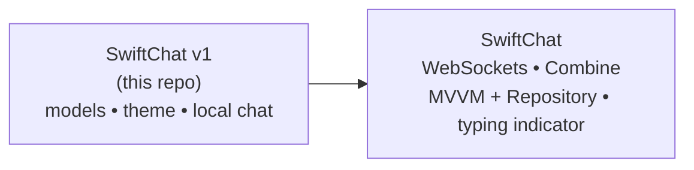

<!-- SwiftChat_ (v1 prototype) — README.md -->

<div align="center">


<br/>


<br/><br/>

<a href="#-getting-started"><b>Getting Started</b></a> •
<a href="#-overview"><b>Overview</b></a> •
<a href="#-whats-inside"><b>What's inside</b></a> •
<a href="#-evolution"><b>Evolution</b></a> •
<a href="#-getting-started"><b>Getting started</b></a> •
<a href="#-contact"><b>Contact</b></a>

</div>

---


<!-- quickstart:start -->
# 🚀 Getting Started

**Requirements:** macOS with **Xcode 26** or later (iOS 26 SDK) and Python 3.9+ for the local test server. No third-party Swift packages.

The complete Xcode project is in `SwiftChat.zip`:

```bash
git clone https://github.com/Navyagowda2714/SwiftChat_.git
cd SwiftChat_
unzip SwiftChat.zip -x "SwiftChat/.git/*"
```

**1. Start the WebSocket server** (broadcasts every message to all connected clients):

```bash
pip install websockets
python server/chat_server.py        # ws://localhost:8080
```

**2. Run the app**

```bash
open SwiftChat/SwiftChat.xcodeproj
```

Select an iPhone simulator and press **⌘R**. Run a second simulator (or the app plus `python -m websockets ws://localhost:8080`) to see messages arrive in real time. To use another backend, change `socketURL` in `App/SwiftChatApp.swift`.
<!-- quickstart:end -->

---

## ✨ Overview

This repository is the **first iteration of SwiftChat** — a SwiftUI chat app prototype. It establishes the core data models (users and messages with **photo and GIF attachments**) and the **visual theme** (gradient background and message bubbles) that were later carried into the full real-time app.

👉 The production-style version with WebSockets, Combine and MVVM + Repository lives in **[Swiftchat](https://github.com/Navyagowda2714/Swiftchat)**.

---

## 📦 What's inside

| Path | Description |
|---|---|
| `ApP/SwiftChatApp.swift` | App entry point — launches `ChatView` with its default `ChatViewModel` |
| `Models/Message.swift` | `Message` model: sender, text, timestamp, optional `UIImage` attachment and remote GIF URL |
| `Models/User.swift` | `User` model with built-in `me` and `bot` users for local conversations |
| `Models/Theme.swift` | `AppTheme`: background gradient and distinct gradients for sent / received bubbles |
| `SwiftChat.zip` | Full Xcode project snapshot (views, view models, networking, resources) |
| `SwiftChat.xcodeproj.zip` | Zipped Xcode project file |

### Design decisions

- **Value-type models** — `Message` and `User` are `Identifiable` + `Equatable` structs, so SwiftUI lists diff efficiently.
- **Media-ready messages** — attachments are optional fields, so text-only and media messages share one model.
- **Centralised theme** — all colours live in `AppTheme`, keeping views free of hard-coded styling.

---

## 🔁 Evolution



---

## 🛠 Getting started

```bash
git clone https://github.com/Navyagowda2714/SwiftChat_.git
cd SwiftChat_
unzip SwiftChat.zip
open SwiftChat/SwiftChat.xcodeproj
```

Run the **SwiftChat** scheme on an iOS simulator or device.

---

## 🤝 Contact

<div align="center">

<a href="https://www.linkedin.com/in/navyashree-byregowda-472821196/"></a>
<a href="https://github.com/Navyagowda2714"></a>
<a href="mailto:navyashreebyregowda@gmail.com"></a>

<br/><br/>
<sub>Built by Navyashree Byregowda · Licensed under the terms in <a href="LICENSE">LICENSE</a></sub>

</div>


